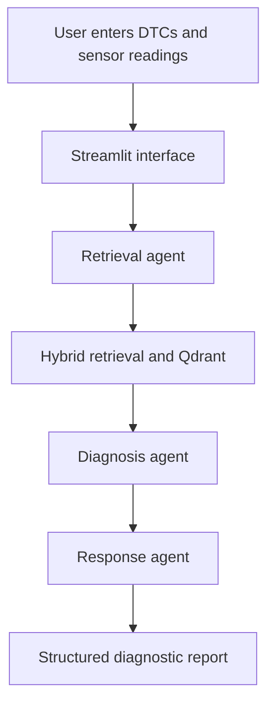

# AutoDiag AI — Agentic Vehicle Fault Investigation System

An AI-powered vehicle fault investigation application that combines diagnostic trouble codes (DTCs), retrieved automotive knowledge, and a multi-agent workflow to generate structured diagnostic reports.

## Overview

Vehicle fault diagnosis often requires investigating fault codes, symptoms, sensor readings, possible causes, and repair procedures across multiple sources.

AutoDiag AI brings these steps into one application. Users provide diagnostic trouble codes and optional freeze-frame sensor readings. The system retrieves relevant information from an OBD-II knowledge base and uses an agentic workflow to produce a structured investigation report.

**Project status:** Working prototype. Diagnostic recommendations require verification by a qualified automotive professional.

## Objectives

- Investigate one or more vehicle diagnostic trouble codes.
- Retrieve relevant automotive information from a vector database.
- Use multiple AI agents to support diagnostic reasoning.
- Present probable causes, severity, diagnostic steps, and recommended actions.
- Explore how retrieval-augmented generation (RAG) and agent orchestration can support automotive troubleshooting.

## Features

- **DTC-based investigation:** Accepts diagnostic trouble codes such as `P0300`.
- **Knowledge retrieval:** Searches a vehicle fault knowledge base using embeddings and hybrid retrieval.
- **Multi-agent workflow:** Coordinates retrieval, diagnosis, and response generation using LangGraph.
- **Structured reports:** Presents probable root causes, severity, immediate actions, and diagnostic steps.
- **Freeze-frame inputs:** Supports additional sensor information where available.
- **Web interface:** Provides an interactive interface using Streamlit.

## Architecture



## Technology Stack

| Component | Technology |
|---|---|
| Language | Python 3.11+ |
| Agent orchestration | LangGraph |
| Language model API | Groq |
| Vector database | Qdrant Cloud |
| Embeddings | Sentence Transformers — `all-MiniLM-L6-v2` |
| Retrieval | Dense and BM25 hybrid retrieval |
| User interface | Streamlit |

## How It Works

1. The user enters one or more DTC codes and optional freeze-frame data.
2. The retrieval workflow searches the automotive knowledge base.
3. The diagnosis agent uses the retrieved context and supplied inputs to investigate possible causes.
4. The response agent prepares a structured diagnostic report.
5. The interface displays the generated report and retrieved documents, where available.

## Project Structure

| Path | Purpose |
|---|---|
| `agents/` | Retrieval, diagnosis, and response agents |
| `pipeline/` | Agent workflow orchestration |
| `retrieval/` | Embedding and retrieval components |
| `data/` | Knowledge-base processing and ingestion |
| `ui/app.py` | Streamlit application |
| `tests/` | Project tests |
| `docs/` | Project documentation and demo assets |
| `requirements.txt` | Python dependencies |
| `.env.example` | Environment-variable template |

## Prerequisites

- Python 3.11 or later
- A Groq API key
- A Qdrant Cloud cluster and API key
- Internet access for hosted APIs and initial model downloads

The application can run locally. Groq and Qdrant free-tier limits apply; free service availability and quotas may change.

## Setup on Windows

Clone your team's repository after it has been created:

```powershell
git clone <YOUR-TEAM-REPOSITORY-URL>
cd <YOUR-REPOSITORY-FOLDER>
python -m venv .venv
.\.venv\Scripts\Activate.ps1
python -m pip install -r requirements.txt
Copy-Item .env.example .env
```

Edit `.env` and supply your own credentials:

```env
QDRANT_URL=your_qdrant_cluster_url
QDRANT_API_KEY=your_qdrant_api_key
GROQ_API_KEY=your_groq_api_key
```

Do not commit `.env` or share API keys in screenshots, source code, or public repositories.

### Knowledge-base setup

If your Qdrant collection has not been populated, and the required local dataset is available, run:

```powershell
python -m data.ingest
```

This process downloads or loads the embedding model, generates embeddings, and uploads records to Qdrant. It may take several minutes. Avoid re-ingesting unnecessarily.

### Start the application

```powershell
python -m streamlit run ui/app.py
```

Open the local URL shown in the terminal, normally `http://localhost:8501`.

## Testing

Run the available tests with:

```powershell
python -m pytest
```

Test coverage and results should be documented after running the tests. Recommended evaluation cases include:

1. A known DTC such as `P0300`.
2. An unknown or unsupported DTC.
3. Multiple related DTCs.
4. Missing or incomplete sensor readings.
5. A case requiring a safety warning or professional inspection.

## Limitations and Safety

- Generated diagnoses are suggestions, not confirmed mechanical findings.
- Retrieved documents can be incomplete, irrelevant, or inconsistent.
- Language-model output may contain incorrect or unsupported claims.
- Results can depend on the supplied sensor data, retrieval quality, and API availability.
- Vehicle-specific repair procedures should be verified using trusted service documentation.
- Never use this prototype as the sole basis for safety-critical repair or driving decisions.

## Roadmap

- Improve retrieval relevance and DTC matching.
- Display evidence supporting individual diagnostic claims.
- Add adaptive follow-up questions when information is missing.
- Show an agent execution timeline and intermediate decisions.
- Handle conflicting evidence and uncertain diagnoses more safely.
- Add automated tests and evaluation metrics.
- Improve the interface and document the final architecture.

## Team and Contributions

**Team members**
- [Vinayak Pawara]
- [Shivam Shivange]

Document each person's actual contributions here as development progresses, including original features, testing, interface improvements, and documentation.

New features and modifications should be documented as the team implements them.
