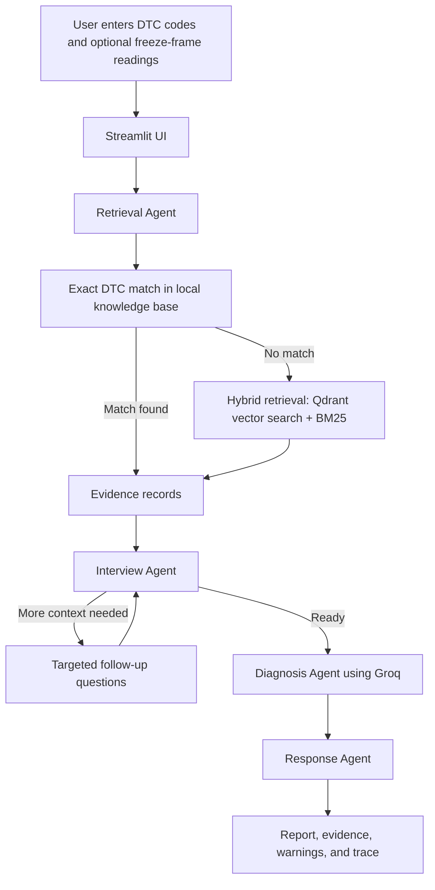

# AutoDiag AI

AutoDiag AI is an evidence-linked OBD-II vehicle fault investigation prototype. It accepts diagnostic trouble codes (DTCs) and optional freeze-frame readings, retrieves matching automotive knowledge, asks targeted follow-up questions when useful, and produces a structured diagnostic report.

> Diagnostic output is guidance only. It is not a confirmed repair diagnosis and must be verified by a qualified technician, especially for safety-critical systems.

## Key features

- **Exact DTC matching first:** Direct matches, such as `P0300`, are retrieved before semantic search. This avoids confusing similarly shaped but unrelated codes such as `P30D8`.
- **Fallback hybrid retrieval:** When no exact record exists, the system uses dense-vector and BM25 retrieval to find possible contextual evidence.
- **Adaptive interview:** The app pauses to ask focused questions when freeze-frame data or symptom context is missing.
- **Evidence-linked reporting:** The report exposes the knowledge-base records, symptoms, causes, and repair steps used as evidence.
- **Uncertainty and safety handling:** Unknown codes, weak evidence, and safety-related information are shown as explicit warnings rather than hidden behind a definitive answer.
- **Visible decision trace:** The interface displays the safe, high-level workflow events that produced the report.

## Architecture



## Agent workflow

| Agent | Responsibility |
|---|---|
| Retrieval Agent | Normalizes codes, prioritizes exact DTC records, performs fallback hybrid retrieval, calculates evidence confidence, and adds safety/unknown-code warnings. |
| Interview Agent | Requests deterministic, relevant follow-up answers for incomplete investigations. |
| Diagnosis Agent | Uses only supplied inputs and retrieved evidence to reason about probable causes and recommended checks. |
| Response Agent | Formats the final report and attaches system-generated evidence, confidence, warnings, and workflow metadata. |

## Technology stack

| Component | Technology |
|---|---|
| Language | Python 3.11+ |
| UI | Streamlit |
| Workflow | LangGraph |
| LLM | Groq via `langchain-groq` |
| Vector database | Qdrant Cloud |
| Embeddings | `all-MiniLM-L6-v2` via Sentence Transformers |
| Keyword retrieval | BM25 via `rank-bm25` |

## Prerequisites

- Python 3.11 or later
- A Groq API key
- A Qdrant Cloud cluster URL and API key
- Internet access for Groq, Qdrant, and the first embedding-model download

## Setup

```powershell
git clone https://github.com/WhitePanda9/AutoDiag-AI.git
cd AutoDiag-AI
python -m venv .venv
.\.venv\Scripts\Activate.ps1
python -m pip install -r requirements.txt
Copy-Item .env.example .env
```

Add credentials to `.env`:

```env
QDRANT_URL=your_qdrant_cluster_url
QDRANT_API_KEY=your_qdrant_api_key
GROQ_API_KEY=your_groq_api_key
```

Never commit `.env` or expose API keys.

## Populate the knowledge base

The application expects a Qdrant collection named `obd_knowledge_base`. The repository includes `data/merged_obd.json`; run the following once for a new Qdrant cluster:

```powershell
python -m data.ingest
```

This downloads/loads the embedding model, creates the collection if needed, and uploads the knowledge-base records. It can take several minutes.

## Run the application

```powershell
.\.venv\Scripts\Activate.ps1
python -m streamlit run ui/app.py
```

Open the local URL printed by Streamlit, normally `http://localhost:8501`.

### Example investigation

Enter `P0301, P0171` and optionally provide:

| Input | Example |
|---|---|
| RPM at fault | `2500` |
| Coolant temperature | `90C` |
| Fuel trim | `+15%` |
| MAP sensor | `45kPa` |

Click **Start investigation**. If the app asks follow-up questions, provide any available vehicle symptoms and click **Continue investigation**. Review the report's confidence, warnings, evidence, and decision trace before relying on any recommendation.

## Tests

Run the regression tests from the repository root:

```powershell
.\.venv\Scripts\python.exe -m unittest discover -s tests -p "test_*.py" -v
```

The included tests cover:

1. Exact `P0300` retrieval excluding unrelated fuzzy neighbors.
2. Unknown-code warning and low-confidence behavior.
3. Follow-up interview question and completion flow.

## Project layout

| Path | Purpose |
|---|---|
| `agents/` | Retrieval, interview, diagnosis, and response agents |
| `pipeline/graph.py` | LangGraph orchestration and interview conditional route |
| `retrieval/` | Qdrant, BM25, embedding, exact-match, and hybrid retrieval code |
| `data/` | Knowledge-base source data and ingestion scripts |
| `ui/app.py` | Streamlit investigation interface |
| `tests/` | Retrieval and interview regression tests |

## Limitations and safety

- The knowledge base is generic OBD-II data, not vehicle make/model-specific service documentation.
- A DTC describes a detected condition, not necessarily the failed part.
- Unsupported codes and weak retrieval evidence should be treated as uncertain; use manufacturer documentation where appropriate.
- Do not work on high-voltage, airbag, brake, fuel-system, or overheating faults without the proper training, safety procedures, and tools.
